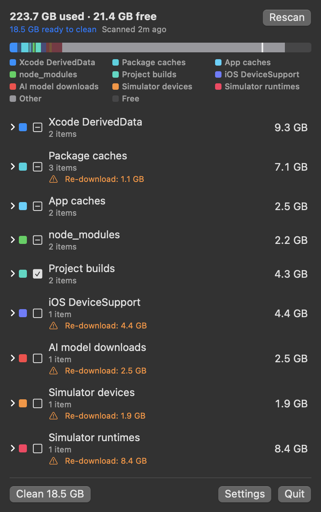
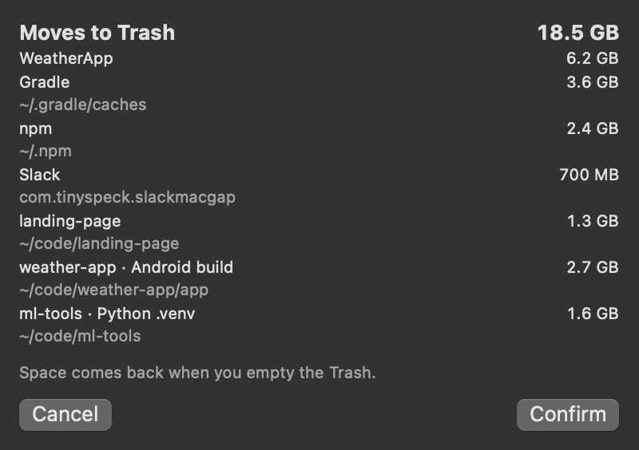
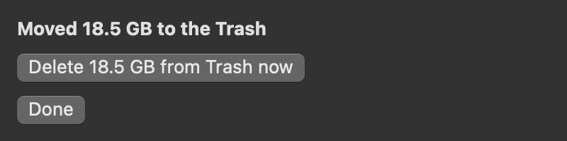
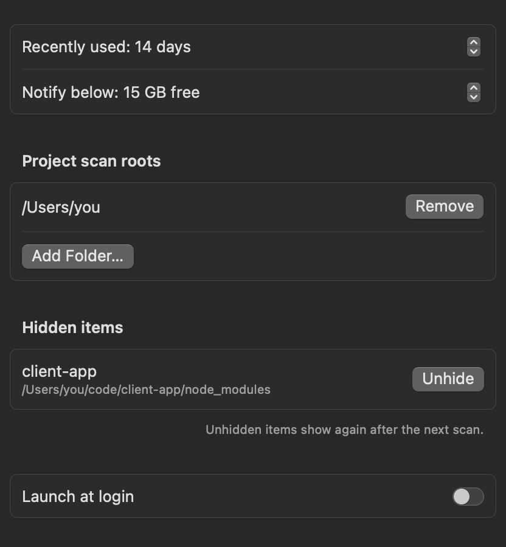

<div align="center">

# 🧹 DevBroom

**Free up disk space eaten by developer junk, right from your menu bar.**

[](https://github.com/sadicelik/DevBroom/releases/latest)
[](https://github.com/sadicelik/DevBroom/releases)


[](LICENSE)



</div>

DevBroom finds the space that Xcode, simulators, `node_modules`, build folders, package caches and AI model downloads quietly take over, shows you exactly how much each one uses, and lets you pick what to clear. It lives next to your free space in the menu bar, has no Dock icon, and **never removes anything until you press Clean and confirm**.

Built for small-disk Macs (it started on a 256 GB MacBook Air) where clearing caches by hand had become a weekly chore.

## Contents

- [Screenshots](#screenshots)
- [What it cleans](#what-it-cleans)
- [How it works](#how-it-works)
- [Safety rules](#safety-rules)
- [Install](#install)
- [First launch](#first-launch)
- [Settings](#settings)
- [FAQ](#faq)
- [Uninstall](#uninstall)
- [Build from source](#build-from-source)
- [Contributing](#contributing)
- [License](#license)

## Screenshots

| Scan results | Clean summary |
|---|---|
|  |  |
| How much is ready to clean, and where free space will end up (the thin line on the bar). Right-click an item to reveal it in Finder. | Everything that will happen, before anything happens. |

| After cleaning | Settings |
|---|---|
|  |  |
| Get the space back straight away: delete only what DevBroom just moved from the Trash. | Recently-used window, low-space alert, project folders. |

## What it cleans

Each row is one of two kinds:

- **Rebuilds:** your tools recreate it on their own. Ticked by default only if you haven't used it in the last 14 days.
- **Re-download:** must be downloaded again later. Shows a warning and is **never** ticked by default.

### Xcode and Apple

| Category | Kind | How it's removed |
|---|---|---|
| Xcode DerivedData | Rebuilds | Trash |
| iOS DeviceSupport | Re-download | Trash |
| Simulator devices | Re-download | `xcrun simctl delete`, permanent |
| Simulator runtimes | Re-download | `xcrun simctl runtime delete`, permanent |
| Wallpaper downloads | Re-download | Trash (only the downloaded videos) |

### Projects

| Category | Kind | How it's removed |
|---|---|---|
| `node_modules` | Rebuilds | Trash |
| Project builds: HarmonyOS `build`, `oh_modules`, `.hvigor` · Android/Gradle `build` · Flutter `build` · Xcode `build` · Rust `target` · Python `.venv` | Rebuilds | Trash |

### Caches and downloads

| Category | Kind | How it's removed |
|---|---|---|
| Package caches: npm, Yarn, pnpm, pip, uv, Homebrew, CocoaPods, Gradle, Gradle wrapper, Cargo, Go modules, Bun | Rebuilds | Trash |
| Package caches: Maven, Dart/Flutter | Re-download | Trash |
| App caches (`~/Library/Caches`) | Rebuilds | Trash |
| AI model downloads (Hugging Face models and datasets) | Re-download | Trash |
| Old VS Code and Cursor extension versions | Rebuilds | Trash |
| Docker images, build cache and stopped containers | Re-download | `docker system prune -a -f`, permanent (volumes are never touched) |

Anything moved to the Trash can be put back until you empty the Trash. The few permanent removals go through the vendor's own tool and need a second confirmation.

## How it works

1. **Click the menu bar icon.** The last results appear at once, then each row refreshes as the new scan finishes.
2. **Pick what to clear.** Old, rebuildable items are already ticked. Open any row to tick or untick single items.
3. **Press Clean.** A summary lists what moves to the Trash and what gets deleted permanently, with sizes.
4. **Confirm.** DevBroom works through the list, skips anything that fails, and tells you what it moved.
5. **Get the space back.** Press **Delete from Trash now** to permanently delete only what DevBroom just moved (it asks once more). Anything else in your Trash is left alone. Or keep it in the Trash and decide later.

Handy extras:

- **Menu bar broom:** shows your free space and turns orange when it drops below your low-space limit.
- **Item counts, sorting and search:** each row shows how many items it holds. Open a row to sort by size, last used or name, and to search rows with more than 10 items.
- **Hide from DevBroom:** right-click an item you always want to keep. It is never offered again until you unhide it in Settings.
- **Keyboard:** ⌘R rescans, ⌘⏎ opens the Clean summary (nothing is removed before you confirm), Esc closes.

Closing the panel stops the scan straight away. Rows that didn't finish keep their old numbers and say "not updated".

## Safety rules

1. **Never touches active work.** Anything used in the last 14 days (you can change this) starts unticked and is tagged "recently used". Just before cleaning, items from an unfinished scan are checked again.
2. **No background scanning.** It scans only while the panel is open. While closed, the only work is a cheap free-space check every minute.
3. **No waiting.** Opening the panel shows the last results at once.
4. **Nothing removed without you.** Nothing is removed until you press Clean and confirm the summary.
5. **Build folders need a project marker.** A build folder is listed only when its project file is present: next to it (for example `build.gradle`, `pubspec.yaml`, `Cargo.toml`, `hvigorfile.ts`, an `.xcodeproj`), or inside it for `.venv`. It is skipped when git tracks any file inside it. "Recently used" is measured over the whole project, so an edit in another module protects the build folder.
6. **Model downloads are never ticked.** They always start unticked and show the re-download warning.
7. **Only old extension versions are offered.** DevBroom lists an editor extension only when a newer version of the same extension sits next to it, and never one listed in the editor's `extensions.json`. If that file is missing, nothing is offered.
8. **One gatekeeper.** Every removal passes a single safety check that refuses anything outside the known locations, anything inside an app bundle, and symbolic links.

## Install

1. Download **`DevBroom.zip`** from the [latest release](https://github.com/sadicelik/DevBroom/releases/latest) and unzip it.
2. Move **`DevBroom.app`** to `/Applications` and open it.

Requirements:

- macOS 14 Sonoma or later, on Apple silicon or Intel.
- Optional: Xcode (for the simulator rows) and Docker Desktop (for the Docker row). Rows for tools you don't have are simply hidden or greyed out.

## First launch

DevBroom is open source and ad-hoc signed, but not notarized by Apple, so macOS blocks the first launch:

1. Open **System Settings → Privacy & Security**.
2. Scroll to the message about DevBroom and click **Open Anyway**. You only do this once.

Prefer Terminal? This does the same:

```sh
xattr -dr com.apple.quarantine /Applications/DevBroom.app
```

You may then see two more prompts:

- **Notifications:** used only for the low disk space alert.
- **Access to Desktop, Documents or Downloads:** the project search starts in your home folder. Saying no just skips that folder. You can narrow the search in Settings.

## Settings

Open the panel and click **Settings**.

| Setting | Default | What it does |
|---|---|---|
| Recently used | 14 days | Items used more recently start unticked. |
| Notify below | 15 GB free | Sends one alert when free space drops below this. |
| Project scan roots | Your home folder | Where DevBroom looks for `node_modules`, build folders and model downloads. Hidden folders and `~/Library` are always skipped. |
| Hidden items | None | Items you hid from the panel. Unhide brings them back at the next scan. |
| Launch at login | Off | Starts DevBroom when you log in. |

## FAQ

**I cleaned, but my free space didn't change.**
Items moved to the Trash still take space until you empty the Trash. After a clean, press **Delete from Trash now** to delete just those items. Docker can also take a few minutes to hand space back after a prune.

**Why are some items unticked?**
They were used recently, they need a re-download, or their app is running. You can still tick them yourself.

**Is it safe to delete simulator runtimes?**
Yes, Xcode downloads them again when you need them, but they are large (often 8 GB or more), so they are never ticked for you.

**Does DevBroom need admin rights or Full Disk Access?**
No. It only touches files in your own user folders and never asks for an admin password.

**Does it send any data anywhere?**
No. DevBroom has no network code. Everything happens on your Mac.

## Uninstall

1. Click the menu bar icon and choose **Quit**.
2. Delete `DevBroom.app` from `/Applications`.
3. Optional: remove its saved scan and settings:

```sh
rm -rf ~/Library/Application\ Support/DevBroom
defaults delete io.github.sadicelik.DevBroom
```

If you turned on Launch at login, turn it off first in Settings (or remove it in **System Settings → General → Login Items**).

## Build from source

You need Xcode 16 or later (Swift 6).

```sh
git clone https://github.com/sadicelik/DevBroom.git
cd DevBroom
swift test                    # run the tests
scripts/build-release.sh      # build dist/DevBroom.app and dist/DevBroom.zip
```

The release script builds a universal binary and signs it ad hoc.

The README screenshots are drawn by the app itself from example data (no screen capture, no real files):

```sh
dist/DevBroom.app/Contents/MacOS/DevBroom --render-screenshots "$PWD/docs/assets" -AppleLocale en_US -AppleLanguages '(en)'
```

## Contributing

Issues and pull requests are welcome. If you'd like DevBroom to clean something new, open an issue with the folder path, the tool that creates it, and how that tool rebuilds it. Please run `swift test` before sending a pull request.

## License

[MIT](LICENSE) © 2026 Sadi Celik
